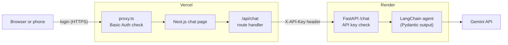
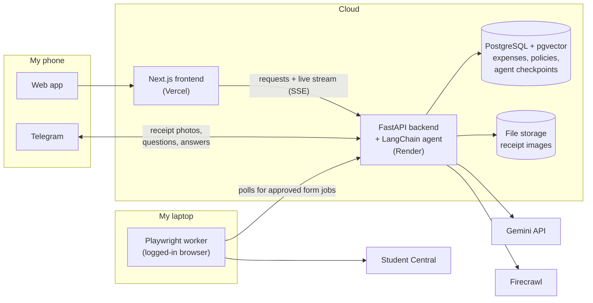

# Treasurer Agent

An AI agent that automates the repetitive parts of being a university student organization treasurer. It researches fundraising and conference funding, answers questions about registered student organization (RSO) policies, turns receipt photos into reimbursement-ready expense records, and fills out university funding forms. A human approves anything that gets submitted.

> **Status:** In active development. The core agent and a deployed end-to-end skeleton (Next.js frontend → FastAPI backend → LangChain agent) are working in a password-protected dev environment. Production launch is in progress, then receipt processing. See the [roadmap](#roadmap).

## Why I'm building this

As a student organization treasurer, I spend a lot of time on repetitive work: reading receipts, checking purchases against funding rules, re-entering the same details into university forms, and searching for funding sources. This project hands that work to an LLM agent, while keeping a person in control of anything involving money.

## What it does

| Capability | How it works | Status |
|---|---|---|
| **Chat with the agent** | A Next.js chat page sends questions through a server-side proxy to a FastAPI backend, which runs the agent and returns a structured answer | Working (dev) |
| **Funding research** | Finds fundraising ideas and conference funding (travel grants, sponsorships) using Firecrawl web search and scraping, and cites its sources | Prototype (placeholder tool) |
| **Policy Q&A** | Answers questions about RSO funding rules using retrieval-augmented generation (RAG) over the university's policy documents | Planned |
| **Receipt processing** | Reads receipt photos with Gemini's image understanding, interprets cryptic item codes, checks the totals, and records each expense | Planned |
| **Human review** | When it's unsure (an unreadable item code, a possible policy violation), the agent messages me on Telegram, waits for my answer, then continues | Planned |
| **Form filling** | Fills out funding and reimbursement forms on Student Central with Playwright; I review and submit | Planned |
| **Live agent view** | Streams the agent's steps and tool calls to the web app in real time | Planned |

## How it works today



1. **Login:** `proxy.ts` runs before every request to the frontend and requires a username and password (HTTP Basic Auth).
2. **Server-side proxy:** the browser only ever calls the app's own `/api/chat` route. That route runs on Vercel's servers and forwards the request to the backend with a shared secret, so neither the secret nor the backend URL reaches the browser.
3. **Backend:** FastAPI rejects any request without the correct secret, then runs the LangChain agent.
4. **Agent:** a single LangChain agent (`create_agent`) on Gemini, with tool calling and a Pydantic response schema, so the answer always comes back as validated `summary` and `sources` fields.

## Target architecture



- **Agent:** one LangChain agent (which builds a LangGraph graph) using the tools below. One agent with well-described tools is easier to debug and evaluate than several cooperating agents.
- **Backend:** FastAPI runs the agent, streams each step to the frontend with Server-Sent Events, and receives Telegram messages through a webhook.
- **Data:** one PostgreSQL database holds expenses, receipt records, saved agent state (so a paused run can resume hours later), and policy embeddings (via pgvector).
- **Form-filling worker:** runs on my laptop, not in the cloud. It checks the backend for approved form jobs, then uses a browser session I've already logged into. Because the worker makes all the connections itself, the laptop never has to accept connections from the internet.

### Agent tools

| Tool | Purpose | Requires my approval | Status |
|---|---|---|---|
| `research_web` | Search and scrape trusted sources with Firecrawl | No | Placeholder |
| `search_policies` | Retrieve relevant RSO policy passages | No | Planned |
| `parse_receipt` | Extract structured line items from a receipt image | No | Planned |
| `lookup_item_code` | Search the web to identify an unrecognized item code | No | Planned |
| `ask_treasurer` | Message me on Telegram and wait for a reply | n/a | Planned |
| `record_expense` | Save a validated expense | No | Planned |
| `submit_form_job` | Queue a Student Central form for the worker | **Yes** | Planned |

## Design decisions

### Implemented

1. **Every boundary checks access.** The frontend requires a login, the backend only accepts requests carrying a shared secret (compared in constant time), and the Gemini API key exists only on the backend. Each service holds only the secrets it needs, and each environment has its own values.
2. **The app degrades gracefully when the model is unavailable.** If the main Gemini model fails, LangChain's `ModelFallbackMiddleware` retries with a lighter model. If Gemini is still unavailable, the API returns a 503 ("try again") rather than a generic 500, and the UI shows that message.
3. **Output is structured and grounded.** The agent returns a Pydantic schema, not free text. Field descriptions tell the model to cite only URLs that came from tool results and to return an empty list otherwise, which prevents invented sources.
4. **Deploys are reproducible.** Python dependencies are pinned, changes go through pull requests, and every merge deploys automatically to its environment.

### Planned

5. **A person approves every submission.** The agent can prepare forms, but LangChain's human-in-the-loop middleware pauses before `submit_form_job`, and I make the final click on Student Central myself.
6. **University credentials never touch the app.** Student Central uses single sign-on with multi-factor authentication. Instead of storing a password, the Playwright worker reuses a browser profile I logged into myself, and it only runs on my machine.
7. **Math is done in code, not by the model.** The LLM extracts line items, and Python checks that the items, tax and total add up. A mismatch sends the receipt to human review.
8. **Web content can't trigger actions.** Crawled pages can contain text written to manipulate an LLM (prompt injection). Research results are treated only as information, and every tool that submits anything requires approval.
9. **Answers are cited and actions are logged.** Every agent run is traced in LangSmith, and every expense links back to its original receipt.
10. **Personal data is minimized.** Receipts can include names and partial card numbers. These are redacted with LangChain's PII middleware before anything is stored or logged.

## Tech stack

| Layer | Technology | Status |
|---|---|---|
| LLM | Google Gemini API (Flash models; image input for receipts) | In use |
| Agent framework | LangChain 1.x (`create_agent`, middleware), LangGraph | In use |
| Structured output | Pydantic | In use |
| Backend | FastAPI | In use |
| Frontend | Next.js 16, React, TypeScript, Tailwind CSS | In use |
| Hosting | Vercel (frontend), Render (backend) | In use |
| Web research | Firecrawl | Planned |
| Browser automation | Playwright (Python) | Planned |
| Database | PostgreSQL + pgvector (Supabase) | Planned |
| Messaging | Telegram Bot API | Planned |
| Observability | LangSmith | Planned |

## Roadmap

- [x] **Phase 0: Core agent.** LangChain agent on Gemini with tool calling and structured Pydantic output.
- [ ] **Phase 0.5: Deployed skeleton.** The full path from browser to agent, deployed early.
  - [x] FastAPI backend wrapping the agent, with model fallback and 503 error handling
  - [x] Next.js chat UI with a server-side proxy route
  - [x] Dev environment on Vercel and Render with automatic deploys from the `dev` branch
  - [x] Basic Auth login and a shared API secret between frontend and backend
  - [x] Pinned Python dependencies
  - [ ] Production environment deployed from `main`
- [ ] **Phase 1: Receipt processing.** Receipt image to validated line items, item-code interpretation, confidence flags, and an evaluation set of real receipts.
- [ ] **Phase 2: Policy RAG.** Load RSO policies into pgvector, answer questions with citations, and check expenses against policy.
- [ ] **Phase 3: Funding research.** Firecrawl research for fundraising and conference funding, with cited sources.
- [ ] **Phase 4: Live agent view and storage.** Stream agent steps to the UI with Server-Sent Events, PostgreSQL storage, and LangSmith tracing.
- [ ] **Phase 5: Human in the loop.** Telegram bot for sending receipt photos and answering the agent's questions; runs pause and resume across conversations.
- [ ] **Phase 6: Student Central forms.** A local Playwright worker fills forms from approved jobs.
- [ ] **Phase 7: Evaluate and harden.** Accuracy evaluations, cost and rate limits, and real user accounts if other officers use the app.

## Development workflow

Changes go through feature branches and pull requests: `feature/*` → `dev` → `main`. Both hosts deploy automatically when a branch updates.

| Environment | Branch | Frontend | Backend |
|---|---|---|---|
| Local | any | `npm run dev` (localhost:3000) | `fastapi dev` (127.0.0.1:8000) |
| Dev | `dev` | Vercel preview deployment | Render dev service |
| Production | `main` | Vercel production deployment | Render production service |

Each environment gets its configuration from environment variables, so the same commit can be promoted from `dev` to `main` without code changes. The deployed app is password-protected because it will handle organization finances, so there's no public demo.

## Getting started

**Prerequisites:** Python 3.13, Node.js 24, and a Gemini API key from [Google AI Studio](https://aistudio.google.com).

**1. Backend**

```bash
git clone https://github.com/PoshLizard/treasurerAgent.git
cd treasurerAgent
python -m venv venv
venv\Scripts\activate            # Windows; on macOS/Linux use: source venv/bin/activate
python -m pip install -r backend/requirements.txt
cp .env.example .env             # then fill in the values
cd backend
fastapi dev
```

To generate a value for `API_SECRET`:

```bash
python -c "import secrets; print(secrets.token_urlsafe(32))"
```

**2. Frontend** (in a second terminal)

```bash
cd frontend
npm install
cp .env.example .env.local       # use the same API_SECRET as the backend
npm run dev
```

Open http://localhost:3000 and log in with your `BASIC_AUTH_USER` and `BASIC_AUTH_PASSWORD`.

## Project structure

```
treasurerAgent/
├── backend/
│   ├── main.py              # FastAPI app: /health and /chat (API key required)
│   ├── agent.py             # LangChain agent: model, tools, fallback middleware
│   ├── tools.py             # agent tools
│   ├── schemas.py           # Pydantic request and response schemas
│   └── requirements.txt     # pinned Python dependencies
├── frontend/
│   ├── app/page.tsx         # chat page (Server Component)
│   ├── app/ui/chat-box.tsx  # chat UI (Client Component)
│   ├── app/api/chat/route.ts  # server-side proxy to the backend
│   └── proxy.ts             # Basic Auth login check
├── .env.example             # backend environment variables
├── LEARNING.md              # build log
└── readme.md
```

Planned additions: `worker/` (Playwright form filling, runs locally) and `evals/` (test receipts with expected results).

## Build log

[LEARNING.md](LEARNING.md) records what I built at each step and what I learned along the way.
